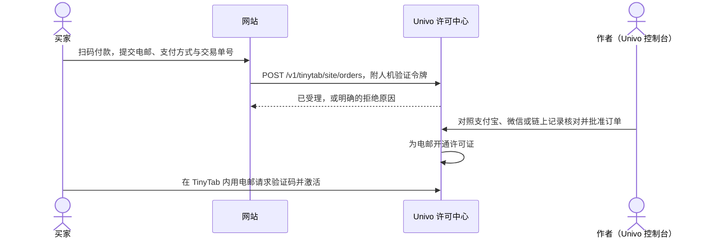

# TinyTab

轻量的 macOS 窗口切换器。用 `Cmd + Tab` 在窗口之间切换，覆盖所有屏幕、所有桌面与全屏空间；每个窗口分配一个字母，按住 `Cmd` 敲下字母即可直达。日常切换完全离线；应用只在激活、刷新和停用时联网，不收集使用数据。

网站：<https://tinytab.xinlu.ink/>

网站源码与 App 安装包都发布在公开仓库 `tinytab/tinytab-official`。网站负责介绍产品、展示价格和收集订单；订单审核、许可证签发与验证由 Univo 许可中心完成，本仓库没有服务端代码。

## 下载与安装

1. 从 [Releases](https://github.com/tinytab/tinytab-official/releases/latest) 下载 `TinyTab.dmg`。
2. 打开 DMG，把 TinyTab 拖入“应用程序”文件夹。
3. 双击 DMG 以及首次打开 TinyTab 时，系统会提示“未打开”“Apple 无法验证是否包含恶意软件”：TinyTab 没有经过 Apple 公证。点“完成”关闭提示（不要点“移到废纸篓”），在“系统设置 > 隐私与安全性”中点“仍要打开”，再打开一次。
4. 按提示授予辅助功能权限。拦截 `Cmd + Tab` 与切换其他应用的窗口都需要这项权限，授权后无需重启 TinyTab。

系统要求：macOS 14 或更高版本。

## 购买与激活

未激活时功能完整可用，每使用一段时间会提醒激活。一次性买断，永久使用。

1. 在[购买页面](https://tinytab.xinlu.ink/#/purchase)扫码付款，提交购买电邮、支付方式与交易单号。
2. 订单通过后，Univo 会向购买电邮发送通知。
3. 从 TinyTab 菜单栏图标选择“激活 TinyTab…”，输入购买电邮，点“发送验证码”。
4. 填入收到的六位验证码，点“激活”。激活后日常切换不再联网；需要时可在激活窗口点“立即刷新”，换机前可以停用这台 Mac。

## 问题反馈

在 [Issues](https://github.com/tinytab/feedback/issues) 中报告问题或提出建议。本仓库的 Issues 已关闭。

## 网站

网站是哈希路由的静态站点，应用会直接链接到这些路径，路径不得更改。

| 路径         | 内容                                     |
| :----------- | :--------------------------------------- |
| `#/`         | 产品介绍：切换面板示意、特性、各页面入口 |
| `#/purchase` | 价格、购买步骤、收款码与付款信息表单     |
| `#/faq`      | 常见问题                                 |
| `#/privacy`  | 隐私政策                                 |

界面支持多语言，优先按浏览器偏好匹配；手动选择的语言记录在网址参数 `?lang=` 中，不使用浏览器存储。

### 购买流程

图中箭头表示前者向后者发起请求或通知。



- 同一交易单号尚未批准的订单可以重新提交，覆盖原订单；已批准的付款再次提交会提示已处理。
- 网站不在浏览器中保存任何内容；电邮与交易单号只随提交发送给许可中心。
- 提交订单需要通过 Cloudflare Turnstile 人机验证。验证组件加载失败时，页面提示买家改用邮件联系作者。
- 主、备用接口按顺序尝试：只有主接口不可达、超时、返回 5xx、429 或无法识别的响应时才换备用接口。明确拒绝（422 加已知代号）、HTTP 400（表单校验错误）与 403 `origin_not_allowed` 不会重试。

### 授权模型

网站在授权流程中只负责提交订单；签发与验证由 Univo 许可中心与 TinyTab 应用完成。

| 角色           | 持有的东西               | 能做什么                             |
| :------------- | :----------------------- | :----------------------------------- |
| 网站           | 无                       | 提交订单；不保存数据                 |
| Univo 许可中心 | 签名私钥、订单与激活数据 | 受理订单；校验验证码；签发许可证凭证 |
| TinyTab 应用   | 受信任公钥列表           | 离线验证凭证                         |

订单请求体字段为 `email`、`offering`、`paymentMethod`、`transactionNumber`、`humanToken`，售卖项固定为 `pro`。凭证格式与签发细节由 Univo 负责。

## 本地开发

环境：Node.js 24 与 pnpm（版本由 `mise.toml` 与 `package.json` 管理）。

```bash
pnpm install
pnpm dev   # 页面：http://localhost:5173
```

开发环境连接 Univo 的预发布接口（`.env.development`），生产构建使用正式接口（`.env.production`）。本地调试提交订单前，需要把 `http://localhost:5173` 登记为 Univo 中产品的官网来源，并加入 Turnstile 组件的域名列表。

检查与测试（与 CI 一致）：

```bash
pnpm format:check && pnpm lint && pnpm check-types && pnpm test && pnpm build
```

`pnpm build` 产出 `dist/`，并运行 `scripts/verify-build.mjs` 检查 CSP 的 `connect-src` 包含正式接口源，产物不含预发布地址与测试密钥，且 `CNAME` 为 `tinytab.xinlu.ink`。

修改 `src/locales/zh-CN.json` 后，运行 `pnpm locales:hant` 重新生成繁体中文；其他语言文件需同步补齐对应文案。

## 部署

网站由 GitHub Actions 部署到 GitHub Pages，不再需要 `pages` 分支或本地发布脚本。

1. 推送到 `main` 分支，或在仓库的 Actions 页面手动运行 `Deploy` 工作流。
2. 工作流依次安装依赖、运行格式检查、静态检查、类型检查与测试，执行 `pnpm build`，把 `dist/` 上传为 Pages 产物。
3. `deploy` 作业用 `actions/deploy-pages` 发布产物，使用仓库自带的 `GITHUB_TOKEN`，不需要额外机密。

自定义域写在 `public/CNAME`（`tinytab.xinlu.ink`），Vite 构建时复制到产物根目录。首次启用时，在仓库 Settings > Pages 把 Source 设为 GitHub Actions，填入自定义域并启用 HTTPS；同时关闭 Issues，问题反馈统一指向 `tinytab/feedback`。

上线前核对 `.env.production` 的 `VITE_API_PRIMARY`、`VITE_API_BACKUP` 与 `VITE_TURNSTILE_SITE_KEY`，并在 Univo 的产品资料中把 `https://tinytab.xinlu.ink` 登记为官网来源，在 Turnstile 组件中允许该域名。收款信息在 `src/config.ts` 的 `PAYMENT_METHODS` 中：每种付款方式只记录二维码的内容，购买页据此绘制统一尺寸的二维码。

## 许可

源码使用 [MIT 许可证](LICENSE)。TinyTab 的名称、图标、截图与文案保留版权，不在 MIT 许可范围内。
